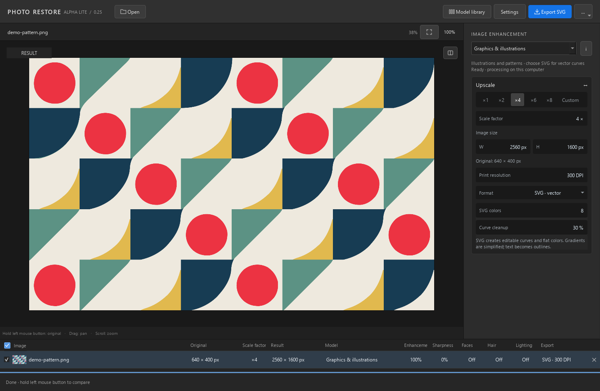

# Photo Restore Studio — Alpha Lite 0.25

Local image restoration and upscaling for Windows. Three focused modes: landscapes
and interiors, portraits, and graphics. RUS / EN interface. This is an early public
alpha: results and hardware compatibility still need testing.

## Download and install

Download just **[Setup.exe](https://github.com/Dgorgik22/photo-restore-studio/releases/download/v0.25.0-alpha-lite/PhotoRestoreStudio-0.25-alpha-lite-Setup.exe)**,
open it, choose a new installation folder and click **Install**. The small installer
downloads the required parts automatically, verifies their SHA-256 checksums, installs
the application and creates a shortcut. Interrupted downloads can resume.
Administrator rights are unnecessary when the destination is writable. Python is not required.
Windows 10/11 with .NET Framework 4.8 is supported.

For offline installation, place all four `part-*.zip` archives next to Setup.exe.
The installer reuses them without downloading again; no separate manifest or script is needed.
Temporary installer downloads are removed after success by default. Adjacent ZIP files are preserved.

Alternatively, extract **all four** ZIP archives into the same folder, then run
`PhotoRestoreStudio/PhotoRestoreStudio.exe`. Each archive contains different files
of the same application. SHA-256 checksums are in the manifest.

The runtime download is approximately 4 GB. Unpacked files require approximately
6.2 GB; the installer applies lossless NTFS compression to libraries and models
where supported. Allow additional space for installation, images and temporary files.
The installer requires a new folder and does not overwrite existing installations.

Windows x64; NVIDIA RTX with 8–12 GB VRAM and 16 GB system RAM recommended.
Photo processing without CUDA may be substantially slower. Compatibility with
every graphics card has not been verified.

## Features

- Landscapes and interiors: restoration and upscaling with cloud, water and surface detail support.
- Portraits: face, neck and hair restoration, with source texture support for clothing.
- Graphics and illustrations: local enlargement and **SVG vectorization**, available only in this mode.
  SVG uses actual curves, a limited palette and contour cleanup. Its preview uses the exported vector.
- PNG / JPEG export, ×1–×8 and custom scale, 15–600 DPI, original/result comparison.
- Live language switching: **Settings → Language → RUS / EN**.

SVG works best with flat artwork. Gradients are simplified. Font recognition,
perfect mathematical circles and automatic pattern repair are not included.
Very small photos lack authentic fine details: restoration may invent features.
Inspect faces, text, hair and geometry before using a result.

## Privacy

Images are processed locally. The release excludes the publisher's credentials,
personal settings, computer reports, logs, caches, photographs and test results.
No account or API key is required. There is no analytics or image upload feature.
The application creates its own local settings and temporary files on your computer.
Optional weekly update checks contact GitHub; explicit model downloads contact
their listed sources. These requests expose the ordinary network address to the
receiving service. Update checks can be disabled in Settings.

## Licenses

Read the bundled `licenses/` notices for libraries, CUDA and models.
**CodeFormer is supplied under S-Lab License 1.0, with noncommercial-use and
redistribution conditions.** Free download does not grant unrestricted commercial
use of this complete bundle. PBRify: CC0; Real-ESRGAN: BSD-3-Clause; VTracer: MIT.
No Topaz software, DLLs or model weights are included.

Source publication alone does not grant a blanket license over the original
application code; third-party components retain their own licenses. No training
or OpenAI cloud editor is included. Future training experiments belong to a
separate development line.

## Русский

**Photo Restore Studio — Альфа Лайт** — локальная программа для восстановления
и увеличения изображений в Windows. Три режима: пейзажи и интерьеры, портреты,
графика и иллюстрации. Поддерживает PNG/JPEG, увеличение ×1–×8, свой масштаб,
15–600 DPI и сравнение с оригиналом. SVG доступен только в режиме графики.

Скачайте только **[Setup.exe](https://github.com/Dgorgik22/photo-restore-studio/releases/download/v0.25.0-alpha-lite/PhotoRestoreStudio-0.25-alpha-lite-Setup.exe)**,
запустите, выберите новую папку и нажмите **«Установить»**. Всё остальное установщик
скачает и проверит сам. Загрузка продолжается после обрыва. Для установки без интернета
положите четыре ZIP-части рядом с Setup.exe — скрипты и manifest отдельно не нужны.
Скачанные установщиком архивы удаляются после успешной установки; ваши ZIP-файлы рядом
с ним сохраняются. Поддерживаются Windows 10/11 с .NET Framework 4.8.
Python не требуется. Язык переключается сразу:
**Настройки → Язык → RUS / EN**.

Размер загрузки — около 4 ГБ, до сжатия на диске — около 6,2 ГБ. Установщик
применяет сжатие NTFS без потерь, если оно доступно. Модели не урезаны.
Рекомендуются Windows x64, NVIDIA RTX с 8–12 ГБ видеопамяти и 16 ГБ ОЗУ.

Изображения обрабатываются на вашем компьютере. Данных, фотографий, ключей и
настроек автора в релизе нет. Проверку обновлений через интернет можно отключить.
Программа создаёт собственные локальные настройки и временные файлы при работе.

Это первая публичная пробная версия. Проверяйте лица, мелкие детали и геометрию.
**Комплект с CodeFormer имеет ограничения на коммерческое использование** —
подробности в `licenses/`. Дообучение запланировано в отдельной версии.
